# Awesome High-Throughput Test Execution Engines ⚡🚀

  

  
  
  
  
  
  

---

## 🌟 Overview & Architecture

> Curated list of elite SaaS platforms, distributed runners, orchestration runtimes, and open-source grids for ultra-fast, high-throughput automated test execution.

In modern CI/CD pipelines and DevOps workflows, automated testing is often the primary bottleneck. A **High-Throughput Test Execution Engine** provides the critical infrastructure layer designed to execute massive test suites concurrently across elastic cloud grids, ephemeral container clusters, or distributed runner worker nodes. 

Whether you are scaling parallel end-to-end (E2E) browser tests, sharding backend unit suites, orchestrating Kubernetes-native integration jobs, or stress-testing APIs with hundreds of thousands of concurrent virtual users, this curated guide tracks the category leaders across commercial SaaS and self-hosted open-source technologies.

### 🎯 Key Architectural Pillars
- **⚡ Dynamic Sharding & Test Splitting**: Intelligent historical timing bin-packing and CI matrix distribution.
- **🔄 Worker Isolation & Concurrency**: Preventing cross-test interference, race conditions, and shared-state flakiness.
- **☸️ Kubernetes-Native Execution**: Eliminating monolithic VM overhead through lightweight on-demand container pods.
- **📊 Unified Telemetry & Result Merging**: Streamlined blob artifact aggregation, flaky test detection, and distributed tracing.

---

## 📑 Table of Contents
- [🌟 Overview & Architecture](#-overview--architecture)
- [📊 Sector Overview & Market Dynamics](#-sector-overview--market-dynamics)
- [☁️ SaaS / Hosted Platforms](#️-saas--hosted-platforms)
- [💻 Open-Source GitHub Projects](#-open-source-github-projects)
- [📈 Star History](#-star-history)
- [💖 Support & Sponsorship](#-support--sponsorship)
- [🤝 How to Contribute](#-how-to-contribute)
- [⚠️ Disclaimer](#️-disclaimer)

---

## 📊 Sector Overview & Market Dynamics

The global test automation and execution orchestration market is estimated at **$35B–$40B** (projected to exceed **$100B+** by the mid-2030s at a ~14% CAGR). The sector is **moderately to highly fragmented** rather than winner-take-all; despite the scale of hyperscalers and cloud giants, the ecosystem remains broadly divided across specialized device cloud grids, CI/CD-embedded execution engines, and rapidly evolving AI-native/open-source testing runtimes.

---

## ☁️ SaaS / Hosted Platforms

| Product | Scale (Revenue / Valuation) | Pricing (Starting) | Free Tier Limits / Free Trial | Description |
|:---|:---|:---|:---|:---|
| **[AWS CodeBuild](https://aws.amazon.com/codebuild/)** | **~$108B–$129B ARR** (AWS business unit) / Amazon: ~$2T+ market cap | **$0.005/minute** (on-demand `build.general1.small`, 2 vCPU, 3 GB RAM) | **100 build minutes/month** indefinitely on `build.general1.small` (Linux) | Managed build and test runner service with pay-per-minute compute and scalable concurrency. |
| **[GitHub Actions Runner](https://github.com/features/actions)** | **~$2.0B+ ARR** (GitHub subsidiary) / Microsoft: ~$3T+ market cap | **$0.006/minute** (Linux 2-core standard runner; Windows: $0.010/min, macOS: $0.062/min) | **2,000 minutes/month** for free accounts on private repos (unlimited minutes on public repos); self-hosted platform fee is $0.002/min consuming free quota | Native CI/CD runner ecosystem with matrix builds, automated sharding, and self-hosted runners. |
| **[BrowserStack Test Execution Engine](https://www.browserstack.com/)** | **$4.0B valuation** (Series B) / **~$230M–$300M ARR** | **$249/month** (Desktop Automate Pro, billed annually, 1 parallel session with unlimited automated test minutes) | **No permanent free tier**; Free trial provides **100 automated testing minutes** (1-hour max single session duration, 1 parallel test) | Enterprise cross-browser and real mobile device cloud supporting Playwright, Cypress, and Selenium. |
| **[CircleCI Runner](https://circleci.com/)** | **$1.7B valuation** (Series F) / **~$55M–$100M ARR** | **$15/month** (Performance plan base + credit consumption) | **30,000 credits/month** (up to ~3,000 build mins on small containers), 30 concurrent jobs, 5 active users, and 5 self-hosted runners | Cloud CI/CD platform offering dynamic test splitting, timing-based parallelism, and self-hosted runner orchestration. |
| **[Sauce Labs Test Runner](https://saucelabs.com/)** | **~$613M valuation** / **~$92M ARR** | **$149/month** (Virtual Device Cloud, billed annually, 1 parallel session with unlimited automated minutes) | **No permanent free tier**; Free trial provides **28-day access** with **60 total automated/live testing minutes**, up to 3 parallel VMs, and 50 Sauce AI queries | Continuous testing cloud providing virtual device emulators, real mobile devices, and orchestration analytics. |
| **[LambdaTest HyperExecute](https://www.lambdatest.com/)** | **~$400M valuation** (Series D) / **~$120M–$150M ARR** | **$103/month per parallel session** (HyperExecute Linux, billed annually; $159/mo for Windows/macOS) | **300 HyperExecute minutes/month** + **2 concurrent sessions** on the Free forever tier (plus 60 mins/month live browser testing) | High-speed, AI-driven test orchestration platform executing distributed tests across multi-cloud environments. |
| **[Cypress Cloud Runner](https://www.cypress.io/)** | **~$255M valuation** (Series B) / **~$18M ARR** | **$67/month** (Team tier billed annually, or $75/mo billed monthly) | **500 test results/month**, up to 10 user seats, and 30-day run data retention on the Free Starter tier | Cloud orchestration for Cypress tests featuring smart parallelization, flake detection, and test replays. |
| **[Aerokube Moon](https://aerokube.com/moon/)** | **~$1M ARR** / Bootstrapped (unfunded) | **$5/month per parallel session** (Moon on-premise/cloud Kubernetes license) | **4 parallel browser sessions free forever** with no license key required; evaluation keys of custom size available for trials | Kubernetes-native cross-browser test execution grid supporting Selenium, Playwright, Puppeteer, and Cypress. |

---

## 💻 Open-Source GitHub Projects

Below are the premier open-source test runners, execution grids, and orchestration platforms sorted in descending order by GitHub Stars. Each repository includes a live stargazer badge linking directly to its stargazer community.

| Project | Stars | Focus & High-Throughput Capabilities |
|:---|:---|:---|
| **[Playwright](https://github.com/microsoft/playwright)** |  | **Next-gen browser automation & ultra-fast parallel test runner.** Apache-2.0, maintained by Microsoft. Built-in worker parallelism (`workers`), native CI matrix sharding (`--shard`), in-process test isolation, resource locking for concurrency, and unified blob report merging. |
| **[Puppeteer](https://github.com/puppeteer/puppeteer)** |  | **High-level Chrome DevTools Protocol automation engine.** Apache-2.0, maintained by Google. Powers headless browser automation, cluster pool managers (puppeteer-cluster), and high-throughput rendering or scraping engines. |
| **[Cypress](https://github.com/cypress-io/cypress)** |  | **Developer-centric end-to-end testing framework.** MIT licensed. Direct in-browser architecture, time-travel debugging, network stubbing, and cross-browser runner core. |
| **[Selenium](https://github.com/SeleniumHQ/selenium)** |  | **The reference WebDriver standard for distributed browser testing.** Apache-2.0. Powers Selenium Grid 4 with dynamic hub-and-node scaling, Docker integration, distributed tracing, and GraphQL topology queries. |
| **[k6](https://github.com/grafana/k6)** |  | **Modern, high-throughput load and performance testing tool.** AGPL-3.0, maintained by Grafana Labs. Built with Go and JavaScript runtime, capable of generating massive concurrent traffic with minimal CPU/memory footprint. |
| **[Locust](https://github.com/locustio/locust)** |  | **Scalable, distributed load testing framework written in Python.** MIT licensed. Event-driven coroutines (gevent) capable of simulating millions of simultaneous users across distributed worker swarms. |
| **[Appium](https://github.com/appium/appium)** |  | **Cross-platform mobile test automation standard.** Apache-2.0. Orchestrates parallel test sessions across real Android/iOS devices, emulators, and simulators through driver plugins. |
| **[docker-selenium](https://github.com/SeleniumHQ/docker-selenium)** |  | **Dockerized Selenium Grid infrastructure.** Apache-2.0. Container images and Compose files for running standalone Chrome, Firefox, and Edge nodes with on-demand video recording. |
| **[Allure 2](https://github.com/allure-framework/allure2)** |  | **Lightweight multi-language test report framework.** Apache-2.0. Aggregates and visualizes massive test execution runs across multiple shards and CI jobs into clear visual dashboards. |
| **[gotestsum](https://github.com/gotestyourself/gotestsum)** |  | **Fast test runner for Go with rich summary formatting and JUnit XML output.** Apache-2.0. Optimizes high-throughput Go unit/integration test runs in CI pipelines with rerun handling. |
| **[Selenoid](https://github.com/aerokube/selenoid)** |  | **Ultra-lightweight Selenium hub written in Go.** Apache-2.0. Spawns fresh Docker containers per browser session with strict concurrency limits (`-limit`), low CPU/RAM overhead, and instant session recycling. |
| **[pytest-xdist](https://github.com/pytest-dev/pytest-xdist)** |  | **Distributed and parallel test runner for pytest.** MIT licensed. Distributes test suites across multiple local CPUs or remote SSH worker nodes with `--dist=loadfile` / `loadscope` balancing. |
| **[Testkube](https://github.com/kubeshop/testkube)** |  | **Kubernetes-native test orchestration platform.** MIT-licensed core. Orchestrates Cypress, Playwright, Postman, K6, and custom runners natively inside Kubernetes clusters without Docker-in-Docker bloat. |
| **[cypress-parallel](https://github.com/tnicola/cypress-parallel)** |  | **Local Cypress test execution parallelizer.** MIT licensed. Reduces suite run times by up to 40% through multi-threaded spec file execution with weight-based historical timing. |
| **[Fairsplice](https://github.com/dashdoc/fairsplice)** |  | **Timing-based balanced test splitting engine for GitHub Actions.** MIT licensed. Uses bin-packing algorithms and historical JUnit XML timings to eliminate bottlenecked CI runner shards. |

---

## 📈 Star History

---

## 💖 Support & Sponsorship

If you find this curated collection of test execution tools valuable, please consider supporting the project:

- ⭐ **Star this repository** to help others discover high-throughput testing tools!
- 🍴 **Fork it** and contribute new runners, performance benchmarks, or orchestration tools.
- 📢 **Share it** on social platforms, developer forums, and DevOps communities.
- ☕ **Sponsor & Buy a Coffee**: Support ongoing maintenance and curated research via the [GitHub Sponsor Dashboard](https://github.com/sponsors/ishandutta2007).

Your support keeps this directory fresh, accurate, and actively maintained! 🙌

---

## 🤝 How to Contribute

1. 🍴 Fork the repository.
2. 🌿 Create a new feature branch (`git checkout -b feature/add-new-engine`).
3. 📝 Add your tool to `README.md` following the alphabetical / star-ranking guidelines and table formats.
4. 🚀 Submit a detailed Pull Request explaining the high-throughput capabilities of the added tool.

---

## ⚠️ Disclaimer

- This list is **community-curated** for architectural research and infrastructure planning; inclusion does not constitute commercial endorsement.
- High-concurrency test execution places heavy compute, memory, and network loads on systems; always ensure rigorous sandboxing, network isolation, credential protection, and cleanup hooks to avoid cross-test pollution or runaway cloud billing.
- All product names, logos, and brands are property of their respective owners.

---

  <b>Crafted with ❤️ for QA Engineers, Platform Architects, and DevOps Teams Scaling Infrastructure.</b>

